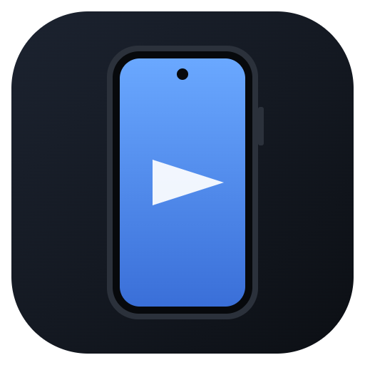
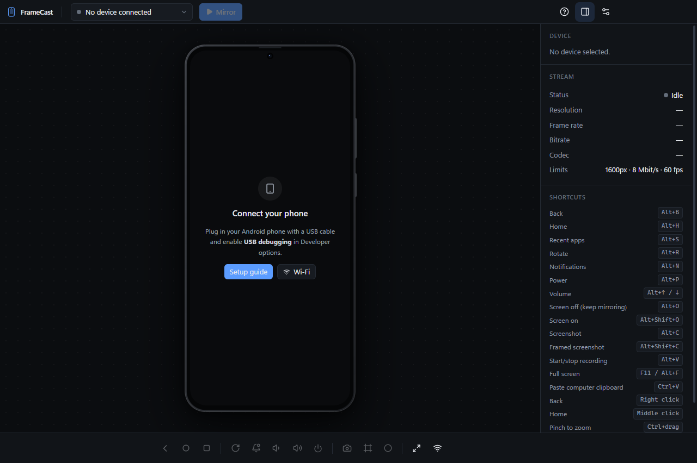
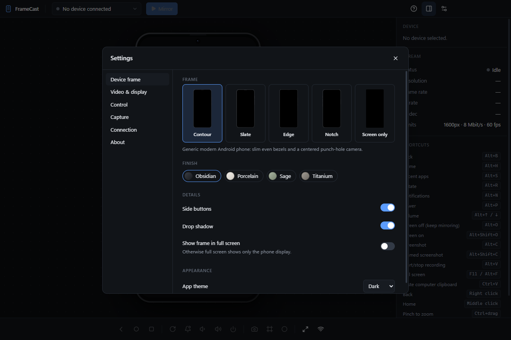
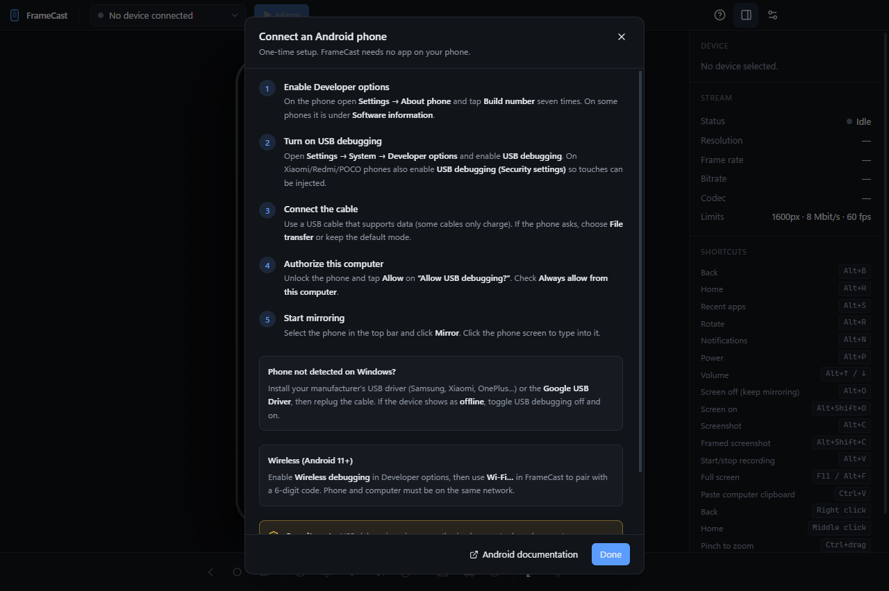
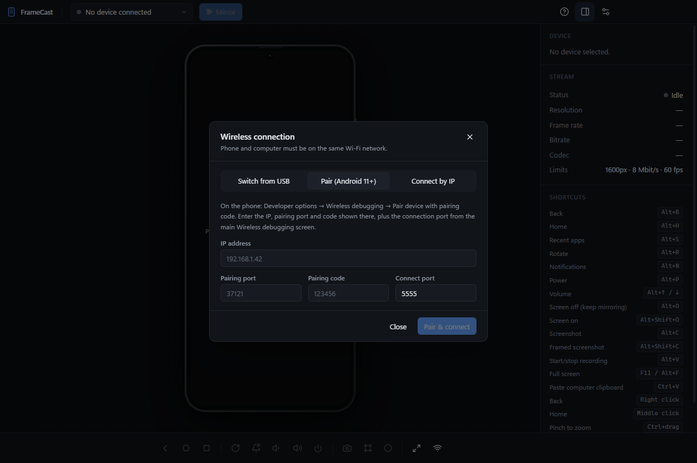

<div align="center">



# FrameCast

**Mirror and control your Android phone on Windows, inside a realistic device frame.**

[](https://github.com/miraclemarcel/framecast/releases/latest)
[](https://github.com/miraclemarcel/framecast/releases)
[](https://github.com/miraclemarcel/framecast/actions/workflows/ci.yml)

[](LICENSE)

<br />

<a href="https://github.com/miraclemarcel/framecast/releases/latest/download/FrameCast-Setup-x64.exe">
  
</a>

<sub>Free · No account · Nothing to install on your phone · <a href="https://github.com/miraclemarcel/framecast/releases">All releases</a></sub>

<br /><br />

[Features](#features) · [Installation](#installation) · [Getting started](#getting-started) · [Usage](#usage) · [Troubleshooting](#troubleshooting) · [Building from source](#building-from-source) · [Contributing](#contributing) · [License](#license)

<br />



</div>

---

## About

FrameCast is a desktop app that shows your **real Android phone** on your PC screen, live, and lets you use it with your
mouse and keyboard. It works like a mirroring tool, but the screen sits inside a polished device frame, so it looks and
feels like a professional emulator. That makes it well suited to app demos, presentations, tutorials, testing and
screenshots for app stores.

It isn't an emulator: no virtual machine and no Android SDK are needed, and it uses very few resources. Your phone does the
work; FrameCast streams it with low latency over USB or Wi-Fi.

## Features

| | |
|---|---|
| 📱 **Real-time mirroring** | Low-latency H.264 stream, hardware-decoded on your GPU. Follows rotation instantly. Adjustable resolution, bitrate and frame rate. |
| 🖼️ **Realistic device frames** | Five original frame styles in four finishes, with punch-hole or notch cameras, side buttons and soft shadows. Frames adapt to your phone's exact screen shape. |
| 🪟 **Compact mode** | Hide the app around the phone. Only the device and a slim side toolbar float on your desktop, like a standalone emulator. Optionally always on top. |
| 🖱️ **Full control** | Tap, swipe, scroll, long-press, pinch-zoom (Ctrl+drag), multi-touch from touchscreens, and Back, Home, Recents, Volume, Power and Rotate. |
| ⌨️ **Keyboard & clipboard** | Type straight into the phone in any keyboard layout or IME. Ctrl+V pastes your PC clipboard; text copied on the phone lands on your PC. |
| 📸 **Screenshots** | Full-resolution PNGs of the phone screen, or framed screenshots ready for store listings and docs. |
| 🎬 **Screen recording** | Records MP4 straight from the phone's video stream, with no re-encoding or quality loss. |
| 📶 **USB & Wi-Fi** | Plug-and-play USB, Wi-Fi pairing with a code (Android 11+), connect by IP, or switch a USB phone to Wi-Fi in one click. |
| 🔄 **Resilient** | Reconnects automatically when the cable is unplugged, Wi-Fi drops or the phone restarts. Clear, human-readable error messages. |
| 🔒 **Private by design** | Runs entirely on your computer. No account, no telemetry, nothing uploaded. |

### Screenshots

<table>
  <tr>
    <td align="center"><br /><sub>Device frames &amp; finishes</sub></td>
    <td align="center"><br /><sub>Built-in setup guide</sub></td>
  </tr>
  <tr>
    <td align="center"><br /><sub>Wi-Fi pairing</sub></td>
    <td align="center"><br /><sub>Main window</sub></td>
  </tr>
</table>

## Installation

### Requirements

| | |
|---|---|
| **Computer** | Windows 10 or 11, 64-bit |
| **Phone** | Android 5.0 (API 21) or newer; Android 11+ for Wi-Fi pairing |
| **Cable** | A USB cable that carries data (not a charge-only cable) |

### Install

1. **[Download `FrameCast-Setup-x64.exe`](https://github.com/miraclemarcel/framecast/releases/latest/download/FrameCast-Setup-x64.exe)**
   from the latest release.
2. Run the installer and follow the steps.
3. Launch **FrameCast** from the Start menu or desktop shortcut.

> [!NOTE]
> The installer is not code-signed yet, so Windows SmartScreen may show *"Windows protected your PC"*. Click
> **More info → Run anyway**. Each release includes `SHA256SUMS.txt`; you can verify your download with
> `Get-FileHash .\FrameCast-Setup-x64.exe`.

Everything FrameCast needs, including ADB, is included. If Android Studio or the Android SDK is installed, FrameCast
automatically uses that ADB instead, so the two never conflict.

## Getting started

### 1. Prepare your phone (one time)

1. **Enable Developer options:** open *Settings → About phone* and tap **Build number** seven times.
2. **Enable USB debugging:** open *Settings → System → Developer options* and turn on **USB debugging**.
   - On **Xiaomi / Redmi / POCO**, also enable **USB debugging (Security settings)**, otherwise taps are ignored.

### 2. Connect

1. Plug the phone into your PC.
2. Unlock the phone and tap **Allow** on *"Allow USB debugging?"*. Tick *Always allow from this computer*.
3. In FrameCast, select your phone in the top bar and click **Mirror**.

Your phone's screen appears inside the frame. Click it to interact, and click it once before typing.

> [!TIP]
> No prompt on the phone, or the phone isn't listed? Open **? → Setup guide** in the app, or see
> [Troubleshooting](#troubleshooting).

## Usage

### Controls

| Action | Mouse / keyboard |
|---|---|
| Tap, swipe, drag | Left click / drag on the screen |
| Scroll | Mouse wheel (Shift + wheel scrolls horizontally) |
| Pinch zoom | Ctrl + drag |
| Back | Right click · <kbd>Alt</kbd>+<kbd>B</kbd> |
| Home | Middle click · <kbd>Alt</kbd>+<kbd>H</kbd> |
| Recent apps | <kbd>Alt</kbd>+<kbd>S</kbd> |
| Notifications (open / close) | <kbd>Alt</kbd>+<kbd>N</kbd> / <kbd>Alt</kbd>+<kbd>Shift</kbd>+<kbd>N</kbd> |
| Rotate | <kbd>Alt</kbd>+<kbd>R</kbd> |
| Volume up / down | <kbd>Alt</kbd>+<kbd>↑</kbd> / <kbd>Alt</kbd>+<kbd>↓</kbd> |
| Power | <kbd>Alt</kbd>+<kbd>P</kbd> |
| Phone screen off / on (keeps mirroring) | <kbd>Alt</kbd>+<kbd>O</kbd> / <kbd>Alt</kbd>+<kbd>Shift</kbd>+<kbd>O</kbd> |
| Paste PC clipboard into the phone | <kbd>Ctrl</kbd>+<kbd>V</kbd> |
| Screenshot / framed screenshot | <kbd>Alt</kbd>+<kbd>C</kbd> / <kbd>Alt</kbd>+<kbd>Shift</kbd>+<kbd>C</kbd> |
| Start / stop recording | <kbd>Alt</kbd>+<kbd>V</kbd> |
| Compact mode (frame only) | <kbd>Alt</kbd>+<kbd>M</kbd> |
| Full screen | <kbd>F11</kbd> · <kbd>Alt</kbd>+<kbd>F</kbd> |

Shortcuts use <kbd>Alt</kbd>, so everything else you type goes to the phone.

### Compact mode

Click the **Compact mode** button in the top bar (or press <kbd>Alt</kbd>+<kbd>M</kbd>). The window shrinks to the
phone alone, with a slim toolbar on its right:

- **Drag the phone's frame** to move it anywhere on your desktop.
- Use **Zoom in / out** to resize it, and **Pin** to keep it above other windows.
- Click **Expand** (or <kbd>Alt</kbd>+<kbd>M</kbd>) to return to the full window.

### Screenshots & recordings

| | Default folder | Format |
|---|---|---|
| Screenshots | `Pictures\FrameCast` | PNG at the phone's native resolution |
| Framed screenshots | `Pictures\FrameCast` | PNG with the device frame and a transparent background |
| Recordings | `Videos\FrameCast` | MP4 (H.264), at the mirroring resolution |

Change the folders, or choose a location every time, in **Settings → Capture**. Rotating the phone during a recording
starts a new file (`…_part2.mp4`).

### Wireless

Open **Wi-Fi** in the bottom bar:

- **Switch from USB:** with the phone plugged in, one click moves it to Wi-Fi. Works on any Android version, and
  the setting resets when the phone reboots.
- **Pair (Android 11+):** on the phone, open *Developer options → Wireless debugging → Pair device with pairing code*,
  then enter the IP address, pairing port, code and connect port.
- **Connect by IP:** for phones that were already paired.

The phone and PC must be on the same network. For smoother Wi-Fi mirroring, use **Settings → Video & display → Performance**.

### Settings

| Section | What you can change |
|---|---|
| **Device frame** | Frame style, finish, side buttons, shadow, frame in full screen, app theme (dark / light / system) |
| **Video & display** | Quality presets, max resolution, bitrate, max frame rate, scaling, info panel |
| **Control** | Clipboard sync, show touches, keep awake, phone screen off while mirroring, lock on stop |
| **Capture** | Screenshot and recording folders, ask where to save |
| **Connection** | Auto-reconnect and retries, auto-start on connect, Wi-Fi port, ADB source |

Settings are saved in `%APPDATA%\FrameCast\settings.json`.

## Troubleshooting

<details>
<summary><b>My phone isn't listed</b></summary>

- Use a data-capable cable and try another USB port (avoid hubs).
- Check that **USB debugging** is on.
- On Windows, install your phone maker's USB driver (Samsung, Xiaomi, OnePlus, …) or the
  [Google USB Driver](https://developer.android.com/studio/run/win-usb), then replug.
</details>

<details>
<summary><b>"Waiting for authorization" / no "Allow USB debugging?" prompt</b></summary>

Unlock the phone, then unplug and replug the cable. If it still doesn't appear, go to *Developer options → Revoke USB
debugging authorizations*, toggle USB debugging off and on, and reconnect.
</details>

<details>
<summary><b>The device is "offline"</b></summary>

Replug the cable, toggle USB debugging, or restart the phone.
</details>

<details>
<summary><b>The screen shows, but taps do nothing</b></summary>

On Xiaomi, Redmi and POCO phones, enable **USB debugging (Security settings)** in Developer options (requires a Mi account).
Some other manufacturers have a similar "disable permission monitoring" option.
</details>

<details>
<summary><b>"The phone could not encode its screen" / black or frozen video</b></summary>

Lower **Settings → Video & display → Maximum resolution** (try 1280 or 1024). *Lower resolution on encoder errors* retries
automatically. Apps that block screen capture (banking, DRM video) show black by design.
</details>

<details>
<summary><b>Choppy over Wi-Fi</b></summary>

Use the **Performance** preset, move closer to the router, or use USB. Guest networks with client isolation don't work.
</details>

<details>
<summary><b>Android Studio and FrameCast keep disconnecting each other</b></summary>

Two different ADB versions are fighting over the ADB server. In **Settings → Connection → ADB executable**, choose
**Android SDK / PATH** so both tools use the same ADB.
</details>

<details>
<summary><b>Something else</b></summary>

Open **Settings → About → Open log folder** and attach `framecast.log` to a
[bug report](https://github.com/miraclemarcel/framecast/issues/new/choose). The log contains no screen content or typed text.
</details>

## How it works

FrameCast pushes the open-source **scrcpy-server** (from the [scrcpy](https://github.com/Genymobile/scrcpy) project) to the
phone over ADB. It runs there only while you mirror, encoding the screen with the phone's hardware encoder and injecting your
input. Everything on the PC side is FrameCast's own TypeScript code:

```
Phone: scrcpy-server ──H.264──▶ Electron main (stream demuxer, MP4 recorder) ──IPC──▶ Renderer (WebCodecs → canvas in the frame)
                     ◀─control── zod-validated input protocol ◀──────────────────── mouse / touch / keyboard mapping
```

Details are in [docs/architecture.md](docs/architecture.md).

## Building from source

**Prerequisites:** Windows 10/11 x64, [Node.js](https://nodejs.org) 22 LTS or newer, Git.

```powershell
git clone https://github.com/miraclemarcel/framecast.git
cd framecast
npm install
npm run fetch-deps   # downloads scrcpy-server 5.0.1 and ADB 37.0.1, checksum-verified
npm run dev          # run with hot reload (F12 opens DevTools)
```

| Command | Description |
|---|---|
| `npm run dev` | Start the app in development mode |
| `npm test` | Run the unit and integration tests (Vitest) |
| `npm run typecheck` | Type-check the main and renderer code |
| `npm run build` | Production build into `out/` |
| `npm run dist` | Full pipeline: deps → typecheck → tests → build → installer in `release/` |

> [!IMPORTANT]
> If you start Electron from VS Code's terminal and see *"reading 'requestSingleInstanceLock'"*, run
> `Remove-Item Env:ELECTRON_RUN_AS_NODE` first. VS Code sets a variable that makes Electron behave like plain Node.js.

### Tech stack

[Electron](https://www.electronjs.org) · [React](https://react.dev) · [TypeScript](https://www.typescriptlang.org) ·
[Vite](https://vite.dev) / [electron-vite](https://electron-vite.org) · [Tailwind CSS](https://tailwindcss.com) ·
[Zustand](https://zustand.docs.pmnd.rs) · [Zod](https://zod.dev) · [Lucide](https://lucide.dev) ·
[mp4-muxer](https://github.com/Vanilagy/mp4-muxer) · [Vitest](https://vitest.dev) · [electron-builder](https://www.electron.build)

### Project structure

```
src/
├── main/                 Electron main process: windows, IPC, mirroring controller, capture, settings, logging
├── preload/              Secure bridge between the UI and the main process
├── renderer/             App shell (full and compact windows), state store, styles
├── components/           Shared UI components
├── features/
│   ├── devices/          Device picker, info panel, Wi-Fi dialog, setup guide
│   ├── mirroring/        Video renderer, input mapping, shortcuts, device stage
│   ├── device-frame/     Frame profiles, geometry, SVG rendering, framed screenshots
│   ├── capture/          Screenshot and recording actions
│   └── settings/         Settings dialog
├── services/
│   ├── adb/              ADB client, locator, output parsing, device monitor
│   ├── scrcpy/           Protocol, stream demuxer, control messages, session
│   ├── capture/          MP4 recorder
│   └── process/          Child-process tracking and cleanup
└── shared/               Types, settings schema, IPC contract, state machine, errors
tests/                    Vitest suites, including a fake device server for socket-level tests
scripts/                  Dependency download and icon generation
docs/                     Architecture and test notes
```

## Roadmap

- [ ] Audio forwarding (Android 11+)
- [ ] Mirroring several phones at once
- [ ] Wi-Fi pairing by QR code
- [ ] Code-signed installer
- [ ] macOS and Linux builds
- [ ] More device frames and custom frame colors

Ideas and votes are welcome in [issues](https://github.com/miraclemarcel/framecast/issues).

## Contributing

Contributions are welcome: bug reports, phone compatibility reports, documentation, device frames and code. Please read
[CONTRIBUTING.md](CONTRIBUTING.md) before opening a pull request.

1. Fork the repository and create a branch: `git checkout -b fix/my-change`
2. Make your change, then run `npm run typecheck` and `npm test`
3. Open a pull request describing what you changed and how you tested it

## Security & privacy

FrameCast runs entirely on your computer: no servers, no telemetry, no accounts. It never uploads your screen, input or
files.

> [!WARNING]
> USB debugging gives any computer you authorize broad access to your phone. Only authorize computers you trust, and turn
> USB debugging off when you're done.

To report a vulnerability, see [SECURITY.md](SECURITY.md).

## License

FrameCast is **source-available** under the [FrameCast Source-Available License](LICENSE). The code is public so you can
use it, learn from it and help improve it.

| ✅ You can | ❌ You can't |
|---|---|
| Download, install and use FrameCast for free, personally or at work | Sell FrameCast, or charge for it or for anything that includes it |
| Read, study and modify the code for your own use | Redistribute FrameCast or modified versions (re-uploads, mirrors, app stores, bundles) |
| Fork the repository to contribute improvements back | Remove copyright notices, or use the FrameCast name/logo for derived products |
| Link to this repository and its releases | |

Third-party components keep their own licenses. See [THIRD_PARTY_NOTICES.md](THIRD_PARTY_NOTICES.md).

## Acknowledgements

- **[scrcpy](https://github.com/Genymobile/scrcpy)** by Genymobile and Romain Vimont: FrameCast runs its excellent
  device-side server (Apache-2.0).
- **[Android Platform-Tools](https://developer.android.com/tools/releases/platform-tools)** for ADB.
- Everyone who reports bugs and tests FrameCast on their phones.

<sub>Android is a trademark of Google LLC. FrameCast is an independent project and is not affiliated with or endorsed by
Google, Samsung, Genymobile or any phone manufacturer. Device frames are original artwork.</sub>

<div align="center">
<br />
<b>If FrameCast is useful to you, consider giving it a ⭐</b>
</div>
